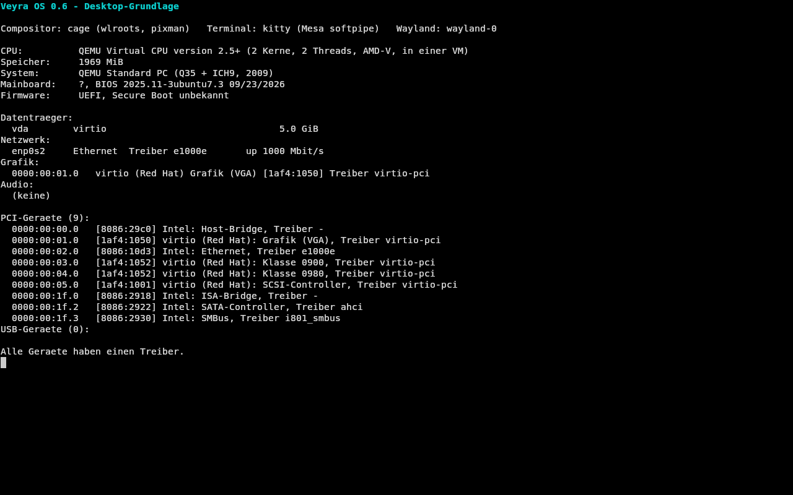

# Desktop-Grundlage (Veyra 0.6, experimentell)

Veyra 0.6 bringt eine erste grafische Sitzung: der Kiosk-Compositor **cage** (auf wlroots)
zeigt ein einziges Vollbild-Terminal, **kitty**. Das ist ein Prototyp für den eigenen Desktop
aus 0.8, kein fertiger Arbeitsplatz: keine Fenster, kein Panel, kein Login-Bildschirm.



*Bildschirmfoto aus dem CI-Job „Desktop in QEMU“, Lauf
[44721414747](https://github.com/MagieGubi/Veyra-OS/actions/runs/44721414747): kitty zeigt die
Ausgabe von `veyra-hwinfo`. Auf echter Hardware ist die Sitzung nie gestartet worden.*

## Benutzen

```sh
vpkg install veyra-desktop     # zieht cage, kitty, foot, seatd, Mesa und Schriften nach
usermod -aG video BENUTZER     # Zugriff auf Grafikkarte und Eingabegeräte über seatd
```

Danach als dieser Benutzer an einer Textkonsole `veyra-desktop` starten. Mit
`VEYRA_TERMINAL=foot veyra-desktop` startet foot statt kitty (ohne OpenGL, als Ausweg, wenn
Mesa auf einer Karte nicht läuft). Wird kitty geschlossen, endet die Sitzung.

Das Basissystem startet unverändert ohne diese Pakete; sie liegen nur im Paket-Repository.

## Aufbau

| Schicht | Paket | Bemerkung |
| --- | --- | --- |
| Kernel | `DRM_VIRTIO_GPU`, `DRM_VMWGFX`, `INPUT_EVDEV`, `VIRTIO_INPUT` | `kernel/config/veyra-80-desktop.config`; i915 war schon da |
| Sitz (Geräterechte) | seatd 0.9.3 als Dienst, Gruppe `video` | Veyra hat kein PAM und keine logind-Sitzungen |
| Eingabe | libinput 1.32, libevdev, mtdev, libxkbcommon, xkeyboard-config | |
| Compositor | wlroots 0.20.2, cage 0.3.1 | wlroots nur mit Software-Renderer pixman und DRM-Dumb-Buffers |
| OpenGL | Mesa 26.3.1 ohne LLVM: softpipe, virgl, svga; EGL für Wayland, kein GLX | |
| Terminal | kitty 0.48.2 (Wayland-only, gegen EGL gelinkt), foot 1.28 | kitten mit Go 1.26 aus Quellcode |
| Schriften | DejaVu, Symbols Nerd Font | fontconfig 2.16, freetype, harfbuzz, cairo |

Gebaut wird alles in Stufe 5 (`build/scripts/ci-stage5.sh` und `ci-stage5-2.sh`, Rezepte in
`packages/desktop/`). Jede Quelle ist per GPG-Signatur oder mit einer zweiten, unabhängigen
Prüfsumme (Arch, Alpine, Buildroot, PyPI) festgeschrieben, siehe `stage4/sources-5.list`,
`sources-6.list` und `sources.lock`.

**Go** wird ohne fremde Binärdateien gebaut: Kette go1.4 (C) → 1.17.13 → 1.20.14 → 1.22.12 →
1.24.13 → 1.26.11. Die Go-Module von kitty lädt `build/tools/fetch-gomod.py` vor dem chroot;
Go prüft jedes gegen `go.sum` aus dem signierten kitty-Archiv. Go und simde sind nur
Bauwerkzeuge und landen nicht im System (der Desktop-Job prüft das).

## Test im CI

Job „Desktop in QEMU (cage, kitty, virtio-gpu, Bildschirmfoto)“ (`image/desktop-test.py`):

1. installiert `veyra-desktop-test` mit vpkg aus dem frisch gebauten, signierten Repository
   in das 0.5-Abbild (nur virtuelle Platte),
2. startet es in QEMU mit `-vga virtio`, virtio-Tastatur und -Tablet,
3. prüft: DRM-Ausgang verbunden, seatd und der Testdienst laufen, cage und kitty laufen als
   unprivilegierter Benutzer `desktest`, kitty hat sein Skript ausgeführt,
4. nimmt per QEMU-Monitor ein Bildschirmfoto und verlangt sichtbaren Text (mindestens drei
   Farben, mindestens 0,2 % Vordergrund). Im Lauf oben: 1280×800, 267 Farben, 4,3 %.

## Grenzen (bewusst, für 0.6)

- **Nur Software-Darstellung.** wlroots rendert mit pixman, kitty mit Mesa softpipe. Das
  reicht für ein Terminal, ist aber langsam. `WLR_RENDERER=pixman` ist gesetzt, weil wlroots
  im Modus „auto“ pixman nicht nimmt, sobald die Karte einen Render-Knoten hat.
- **Kein iris (Intel), kein radeonsi, kein NVIDIA.** Der Intel-Treiber iris braucht ab Mesa
  25 den OpenCL-Compiler mesa_clc und damit LLVM und Clang; das kommt mit 0.8.
- kitty 0.48.2 ist die letzte Version ohne den Shader-Compiler slangc.
- Kein Xwayland, kein Ton, keine Sitzungsverwaltung, kein grafischer Login.
